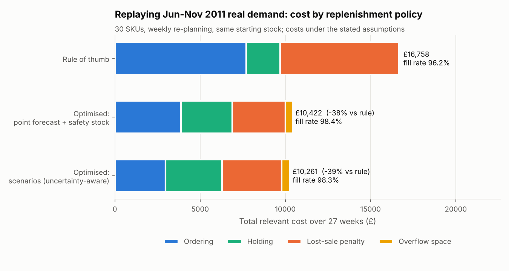
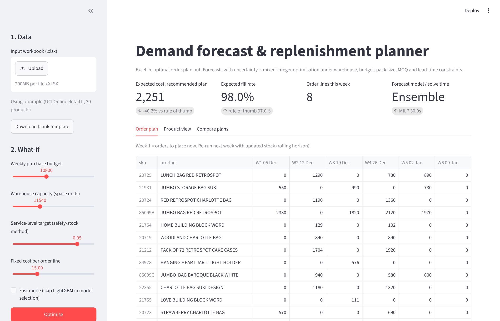
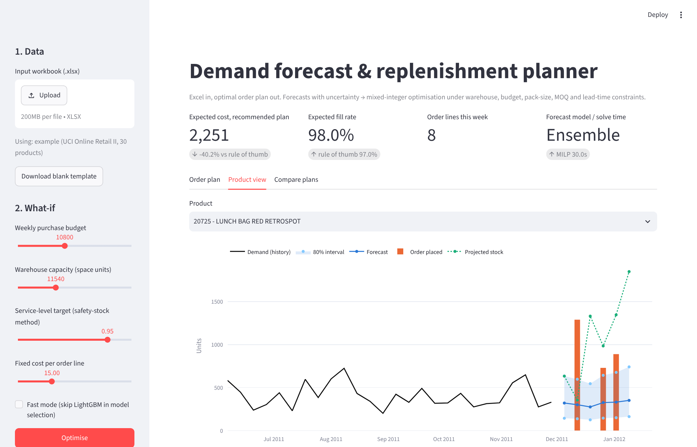
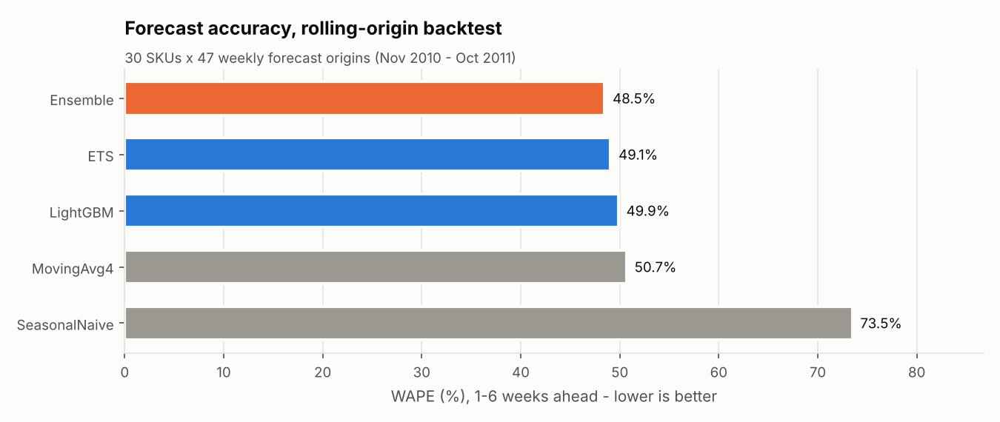
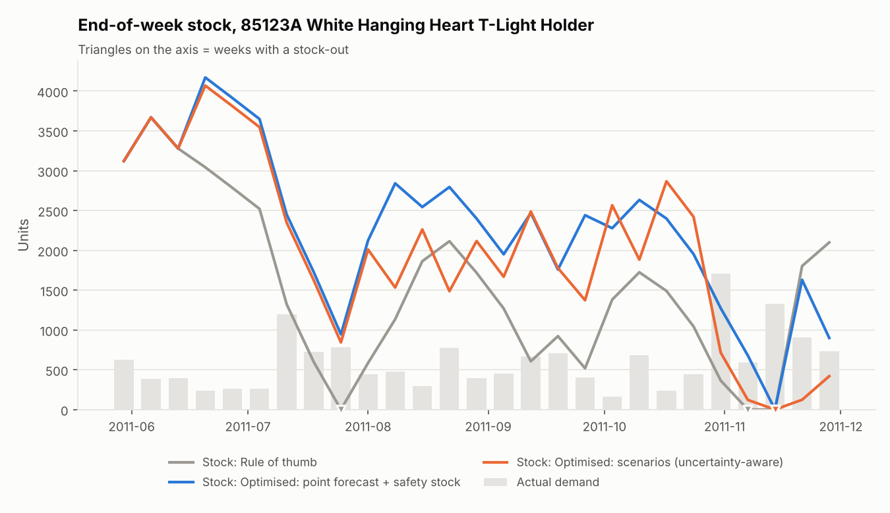

# inventory-forecast-optimizer

**Excel in, optimal reorder plan out.** This tool forecasts weekly demand per product, with uncertainty. A mixed-integer program then decides how much to order each week, within warehouse space, cash budget, pack sizes, minimum order quantities and lead times. Both steps are checked by replaying real historical demand.

Replaying 27 weeks of real demand for 30 products (Jun–Nov 2011, UCI Online Retail II), under the cost assumptions listed below:

| Policy | Total relevant cost | vs rule of thumb | Fill rate | Stock-out SKU-weeks | Orders placed |
|---|---:|---:|---:|---:|---:|
| Rule of thumb: every week, order up to (lead time + 2 weeks) × last-4-week average | £16,758 | – | 96.2% | 59 | 514 |
| Same rule, best settings **chosen in hindsight** on the test period | £12,852 | −23% | 99.0% | 13 | 502 |
| Optimised: point forecast + safety stock (MILP) | £10,422 | −38% | 98.4% | 16 | 259 |
| **Optimised: demand scenarios (uncertainty-aware MILP)** | **£10,261** | **−39%** | 98.3% | 20 | 198 |

* Compared with the plain rule of thumb, the uncertainty-aware plan costs **39% less**, has **66% fewer stock-out SKU-weeks** and **56% fewer lost units**. It places **61% fewer order lines**.
* Even against the rule of thumb with settings tuned on the test period itself (which no real buyer could do), it is **20% cheaper**.
* **Hold-out check:** Mar–May 2011 was never looked at while designing the method. There the uncertainty-aware plan is **42% cheaper** than the rule of thumb and **8% cheaper** than point forecast + safety stock (`reports/policy_comparison_holdout.csv`).
* On the main test period the two optimised versions are within 1.5% of each other, which is about the size of the solver's time-limit noise. The honest summary: *most of the money comes from optimising at all (batching orders, respecting the shared budget and space). Modelling uncertainty explicitly adds a smaller, consistent gain.*

> All costs are relevant costs under **assumed** cost parameters (the dataset has no purchase costs). They are listed in [Data & assumptions](#data--assumptions) and in `reports/assumptions.csv`. Change them in the Excel template and the numbers change too.



## Screenshots

| | |
|---|---|
|  |  |
| Web app: upload Excel, move budget/capacity sliders, get the plan | Forecast with 80% interval, planned orders, projected stock |
|  |  |
| Rolling-origin backtest of 5 forecasting models | Replay of one product under the three policies |

## What it does

1. **Forecast.** Each SKU gets weekly forecasts 1–6 weeks ahead from five models, compared in a rolling-origin backtest. The best one on past data is used, and its own past errors give the uncertainty.
2. **Optimise.** A MILP chooses order quantities per SKU and week, minimising expected ordering + holding + lost-sale + overflow-space cost.
3. **Simulate.** Week by week, each policy orders using only information available at that time. The real demand then hits, unmet demand is lost, and costs are booked. The plan is re-optimised every week (rolling horizon).
4. **Excel in / Excel out.** A client fills in `examples/input_template.xlsx` (products, costs, stock, open orders, sales history). They get back `examples/output_plan.xlsx`: the order plan, forecast detail and a cost comparison against the rule of thumb.

## Method

### Forecasting (`src/invopt/forecast.py`)

| Model | Idea |
|---|---|
| Seasonal naive | same week last year |
| Moving average (4 w) | the "last month" baseline |
| ETS | Holt's damped trend on log(1+demand), per SKU; parameters re-estimated every 4 weeks |
| LightGBM | one global model per horizon; lags, rolling means, last-year same-week ratio, week of year; all scaled by the SKU's recent level; L1 (median) loss |
| Ensemble | mean of ETS and LightGBM |

Backtest: 30 SKUs × 47 weekly origins × 6 horizons (8,340 forecasts per model). Every forecast uses only data up to its origin, and a unit test checks this. Shop-closure weeks at Christmas are excluded from the scoring.

| Model | WAPE | Bias |
|---|---:|---:|
| Ensemble | **48.5%** | −4.6% |
| ETS | 49.1% | −5.8% |
| LightGBM | 49.9% | −3.4% |
| Moving average (4 w) | 50.7% | +1.8% |
| Seasonal naive | 73.5% | +30.1% |

Weekly demand of a single wholesale product is very noisy (a few big customer orders dominate). The best models beat the 4-week moving average by only ~4%. The real value is in the next step: knowing *how wrong* the forecast tends to be. The 80% prediction intervals (P10–P90) contained the actual value **82–84%** of the time.

### Uncertainty → demand scenarios

Past forecast errors (actual ÷ forecast, 1–6 weeks ahead) are collected from the backtest, using only errors that were already observable. Their distribution is cut into **14 weighted scenarios**, with finer steps in the upper tail where stock-out risk lives (the top scenario sits at the 99.85% level). Two design choices came out of a calibration check (`reports/scenario_calibration.csv`):

* **Pool errors across SKUs.** Each SKU has only 15–40 past errors, so its own tail is too thin. Pooled errors put real demand above the scenario P90 in 8–10% of cases (target 10%). Per-SKU errors gave 13–20%.
* **Centre on the median, keep the skew.** Forecasts ran high in H1 2011 and low in the Q4 ramp-up, so the past average bias should not be carried forward.

### Optimisation model (`src/invopt/optimize.py`, OR-Tools + open-source SCIP)

Decision variables per SKU *i* and week *t* (t = 0 is "now"):

* `n[i,t]` integer cases ordered (`Q = case_size × n`)
* `y[i,t]` binary order/no-order
* `I[s,i,t]` stock per scenario *s*
* `U[s,i,t]` lost sales per scenario
* `O[t]` overflow space

```
min   Σ K·y  +  Σ_s prob_s Σ (h·I + p·U)  +  c_over·Σ O
s.t.  I[s,i,t] = I[s,i,t-1] + Q[i,t-L_i] - D[s,i,t] + U[s,i,t]     inventory balance, lead time L_i
      0 ≤ U[s,i,t] ≤ D[s,i,t]                                      unmet demand is lost
      Σ_i space_i·(expected stock at start of week t) ≤ capacity + O[t]   warehouse (soft: overflow is rented)
      Σ_i cost_i·Q[i,t] ≤ weekly budget                            cash
      MOQ_i·y[i,t] ≤ Q[i,t] ≤ M[i,t]·y[i,t]                        minimum order, fixed cost per order line
```

* **Point-forecast version:** one scenario (the forecast) plus a soft safety-stock target `z·σ·√(L+1)`.
* **Scenario version:** the same order plan must work for all 14 weighted scenarios, and expected cost is minimised.
* **Size and speed:** ~5,500 variables. Typical solve times are 5–30 s for the scenario version (time limit 30 s, gap ≤ 0.1%) and 1–4 s for the point version.
* **Purchase price** is not in the objective. Every unit sold is bought once at the same price whatever the timing; cash is limited by the budget constraint.
* **Lessons from building it:**
  1. Tight per-order big-M bounds made the MILP ~10× faster.
  2. The relative MIP gap must be small (0.1%). The objective contains a large unavoidable lost-sales part, so at 1% the solver ignored single-SKU decisions worth £20–50.
  3. A two-stage "recourse" variant solved 5× faster but over-stocked. See the design table below.

### Simulation (`src/invopt/simulate.py`)

* Same starting stock for every policy.
* Weekly re-planning; the policy only sees the past.
* Lost sales.
* Costs: £15 per order line, holding, lost-sale penalty, overflow space. Purchase spend and turnover are also reported.
* The forecasting model is chosen using only backtest errors from before the test period (it chose the Ensemble), and parameters such as MOQ and budget are sized from pre-test data too.

### Robustness and things that did not work

**Sensitivity to the assumed fixed order cost.** See `reports/sensitivity_fixed_order_cost.csv`; this is the assumption that most affects the batching gain.

| Fixed cost per order line | Rule of thumb | Point + safety stock | Scenarios | Saving (scenarios) |
|---|---:|---:|---:|---:|
| £5 | £11,618 | £7,518 (−35%) | £7,016 | **−40%** |
| £15 (main) | £16,758 | £10,422 (−38%) | £10,261 | **−39%** |
| £30 | £24,468 | £12,953 (−47%) | £11,438 | **−53%** |

Across a 6× range of this assumption both optimised plans save 35–53% vs the rule of thumb, and the scenario version is cheapest in every case; the lower end is the safer number to quote.

**Scenario designs tried** on the main test period (`reports/scenario_design_ablation.csv`). The design was settled using the calibration check; the hold-out period was not used for any of these choices.

| Scenario design | Total cost | Stock-out SKU-weeks |
|---|---:|---:|
| A. own-SKU errors, raw | £11,635 | 44 |
| B. own-SKU errors, mean-centred | £11,047 | 40 |
| C. pooled + two-stage recourse | £11,979 | 35 |
| D. C + capacity checked per scenario | £11,291 | 39 |
| E. D with 20 Latin-hypercube scenarios | £10,709 | 31 |
| **F. pooled, median-centred, 14 tail-weighted (default)** | **£10,261** | 20 |
| reference: point forecast + safety stock | £10,422 | 16 |

## How to run

Requirements: Python 3.11+. All solvers are open source and ship inside OR-Tools, so no licence is needed.

```bash
git clone https://github.com/dgh19981102-max/inventory-forecast-optimizer
cd inventory-forecast-optimizer
python -m venv .venv && source .venv/bin/activate      # Windows: .venv\Scripts\activate
pip install -r requirements.txt

# a) just use the tool on the example workbook (~1-2 min, of which the MILP <= 30 s)
python scripts/plan_from_excel.py examples/input_template.xlsx my_plan.xlsx
streamlit run app/streamlit_app.py                    # interactive version

# b) reproduce the study (raw data needed, see below)
python scripts/prepare_data.py          # raw transactions -> weekly demand of 30 stable SKUs
python scripts/run_backtest.py          # forecast backtest + figures              (~2 min)
python scripts/check_scenario_calibration.py
python scripts/run_simulation.py        # 3 policies, hindsight-tuned rule, hold-out (~15 min)
python scripts/run_sensitivity.py 5 30  # fixed-order-cost sensitivity            (~10 min each)
python -m pytest -q                     # 11 tests: no look-ahead, constraints, Excel round trip
```

`data/processed/` is committed, so steps after `prepare_data.py` run without the raw file.

**Your own data:** copy `examples/input_template.xlsx` and replace the three sheets:

* **Settings**: capacity, budget, horizon
* **Products**: costs, pack size, MOQ, lead time 1–2 weeks, stock, open orders
* **DemandHistory**: ≥ 60 weeks of weekly unit sales, one column per product code

Then run `plan_from_excel.py` or upload the file in the web app.

## Data & assumptions

**Demand data:**

* Source: [UCI Online Retail II](https://archive.ics.uci.edu/dataset/502/online+retail+ii) (Chen, 2019), licence **CC BY 4.0**. It holds the transactions of a UK online gift wholesaler, Dec 2009 – Dec 2011.
* The copy used here (SHA-256 of the CSV export `463efe19…0fd31`) has the official 1,067,371 rows.
* To get it, download `online_retail_II.xlsx` from UCI into `data/raw/`; `prepare_data.py` converts it.

**Cleaning:**

* Removed the 9-day overlap between the two Excel sheets, exact duplicates, cancellations, returns, zero prices and non-product codes (postage, fees…).
* Aggregated to weeks (Monday start); weeks without sales count as 0.
* Christmas closure weeks are filled with neighbour averages for model fitting only.
* The last, partial week is dropped.

**SKU selection:** sold in ≥95% of weeks, ≥40 units/week, then the 30 with the lowest coefficient of variation. This uses the whole period, which is a mild look-ahead accepted to get products with a full life cycle.

**Cost and constraint assumptions** (the dataset has none; all are editable in the template):

| Parameter | Assumption |
|---|---|
| Unit purchase cost | 55% of median selling price (45% gross margin) |
| Holding cost | 26% per year of unit cost + £0.004 per storage-space unit per week |
| Lost-sale penalty | lost margin + 10% of price for goodwill |
| Fixed cost per order line | £15 |
| Pack size | most frequent order-line quantity in the data |
| Minimum order quantity | ≈ 1 week of average demand, rounded up to packs |
| Lead time | 2 weeks for imported-looking items (cabinets, building blocks, T-light holders), 1 week otherwise |
| Storage space per unit | by product family (card 0.05 … cabinet 6.0) |
| Warehouse capacity | 3 weeks of average total space need (soft; overflow rented at £0.05 per space unit per week) |
| Weekly purchase budget | 1.6 × average weekly purchase cost |
| Starting stock in simulation | (lead time + 1) weeks of recent demand, identical for every policy |

**Limitations:**

* Demand is treated as fully observed (orders placed while out of stock are still in the data).
* Lead times are deterministic.
* The rule of thumb is one common heuristic, not the only one; the hindsight-tuned version is included for that reason.
* Savings depend on the assumptions above, especially the fixed order cost.

## Repository layout

```
src/invopt/   data.py  forecast.py  params.py  optimize.py  simulate.py  planner.py  excel_io.py  figures.py
scripts/      prepare_data · run_backtest · check_scenario_calibration · run_simulation · run_sensitivity
              make_excel_template · plan_from_excel · make_figures
app/          streamlit_app.py
examples/     input_template.xlsx  output_plan.xlsx
reports/      all result tables (csv) + figures/
tests/        pytest suite
```

## Related work

The scenario-based optimisation reuses ideas from my [microgrid-dispatch-milp](https://github.com/dgh19981102-max/microgrid-dispatch-milp) project (MILP + stochastic MPC for battery dispatch).

---
MIT licence · Guohao D. · MATLAB & Python engineer: simulation, optimisation, scientific ML
